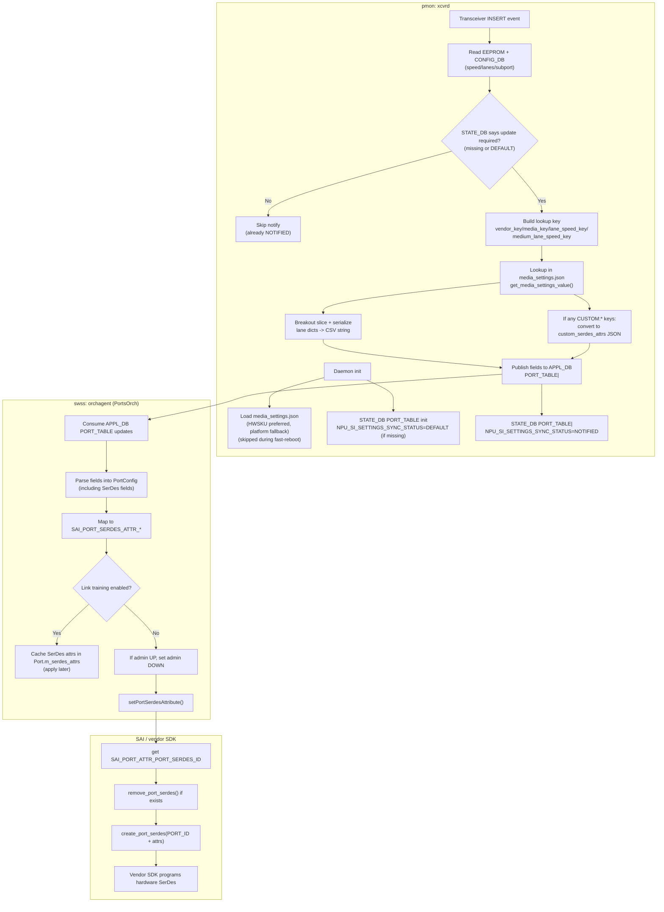
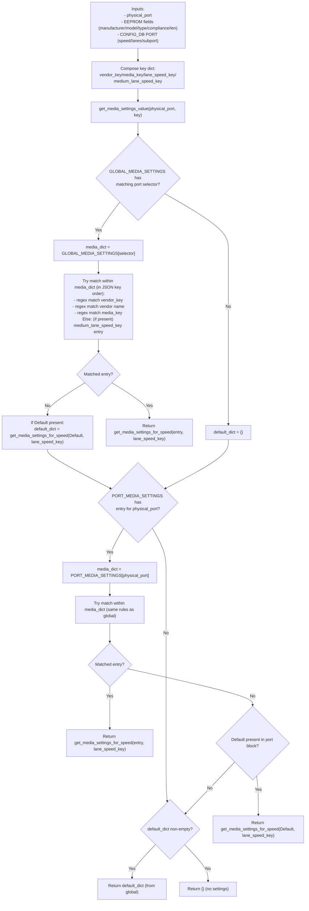

# Media-based Port Settings (SerDes/SI) — Design, Implementation & Debug Guide

This is a standalone onboarding + developer/debug reference for SONiC media-based port settings, written to match the current implementation in `sonic-platform-daemons` (`xcvrd`), `sonic-swss` (`PortsOrch`), and SAI. It includes both a high-level overview and the key code paths/DB fields used in practice.

References (optional):

- `doc/media-settings/Media-based-Port-settings.md` (original HLD-style doc)
- `doc/port-si/Port_SI_Per_Speed.md` (per-lane-speed SI enhancements)

## Problem statement and motivation

Different optics/DACs can require different ASIC SerDes/SI settings (TX FIR taps, pre-emphasis, polarity, vendor-private knobs, etc.) for acceptable BER/CRC behavior. These settings often depend on:

- module type and compliance (SR/LR/CR, CMIS vs non-CMIS, etc.)
- cable length (for copper)
- lane speed / host electrical interface
- vendor + part number
- breakout mode (subport/lane slicing)

SONiC supports a platform-provided `media_settings.json` file that lets vendors express a mapping from “detected media” → “port settings to apply”, so that new media types can often be supported by updating JSON rather than upgrading the NOS image.

## Key concepts / terminology

- **Physical port**: front-panel index used by platform APIs (often `1..N`).
- **Logical port**: SONiC port name (e.g., `Ethernet0`) used in DB tables and swss.
- **Lane count**: number of lanes in the logical port (`CONFIG_DB` `PORT|<name>` `lanes`).
- **Subport (`subport`)**: breakout index used by `xcvrd` to slice lane settings for breakout ports.
- **Ganged port**: one logical port mapped to multiple physical ports; `xcvrd` may publish `EthernetX:<n> (ganged)`.
- **vendor_key**: `<manufacturer>-<model>` (manufacturer uppercased).
- **media_key**: `<type_abbrv_name>-<compliance>[-<len>M]` (see details below).
- **lane_speed_key**: per-lane-speed selector like `speed:25G` or `speed:400GAUI-8`.

## Architecture overview (end-to-end)

1. Platform/vendor provides `media_settings.json` (rules + settings).
2. On transceiver insert, `pmon#xcvrd`:
   - builds a lookup key from EEPROM + port configuration,
   - resolves a settings dictionary from `media_settings.json`,
   - publishes fields to `APPL_DB` `PORT_TABLE` for the port.
3. `swss#orchagent (PortsOrch)` consumes `APPL_DB` `PORT_TABLE` updates and maps SI-related fields to SAI Port SerDes attributes.
4. `swss` programs SerDes by deleting/recreating the `SAI_OBJECT_TYPE_PORT_SERDES` object (via SAI) for that port.
5. Vendor SAI implementation applies the SerDes settings in hardware.

### Event flow diagram

The following diagram reflects the current code path (see `sonic-xcvrd/.../media_settings_parser.py` and `orchagent/portsorch.cpp`).



### Key selection diagram (JSON lookup)

The current lookup is implemented in `sonic-xcvrd/xcvrd/xcvrd_utilities/media_settings_parser.py:get_media_settings_value()`.



Notes that matter for real JSON authoring (current behavior):

- The per-block match uses regex (`re.match`) and iterates keys **in JSON order**.
- The `medium_lane_speed_key` fallback is checked during the iteration; if it exists it may be returned early depending on key order. Keep specific vendor/media keys first.
- Per-speed support is detected by checking whether the **first** key in a settings dict starts with `speed:`; keep `speed:*` keys first in that dict.

## Code pointers (where to read first)

### xcvrd (sonic-platform-daemons)

- `sonic-xcvrd/xcvrd/xcvrd_utilities/media_settings_parser.py`
  - `load_media_settings()`
  - `get_media_settings_key()`
  - `get_media_settings_value()` / `get_media_settings_for_speed()`
  - `notify_media_setting()`
  - `handle_custom_serdes_attrs()`
- `sonic-xcvrd/xcvrd/xcvrd.py`
  - transceiver insert/remove event handling (calls `notify_media_setting()`)
  - initializes and updates `STATE_DB` gating fields
- `sonic-xcvrd/xcvrd/xcvrd_utilities/xcvr_table_helper.py`
  - DB table objects for `APPL_DB` `PORT_TABLE` and `STATE_DB` `PORT_TABLE`

### PortsOrch (sonic-swss)

- `orchagent/port/portschema.h` (field names expected in `APPL_DB` `PORT_TABLE`)
- `orchagent/port/porthlpr.cpp`
  - `PortHelper::parsePortSerdes()` (parses comma-separated per-lane values)
- `orchagent/portsorch.cpp`
  - `getPortSerdesAttr()` (maps parsed fields to `SAI_PORT_SERDES_ATTR_*`)
  - `PortsOrch::setPortSerdesAttribute()` (recreates the SAI Port SerDes object)
  - Link-training interactions (caching/restoring SerDes)
- `orchagent/port.h`
  - `SerdesValue` + `SerdesValueVisitor` (supports list values and JSON strings)

### SAI headers (SAI repo)

- `inc/saiport.h`
  - `sai_port_serdes_attr_t` (e.g., `SAI_PORT_SERDES_ATTR_PREEMPHASIS`, `..._CUSTOM_COLLECTION`)
- `inc/saitypes.h`
  - `sai_json_t` (JSON payload type used by `..._CUSTOM_COLLECTION`)

## Runtime file location and load behavior

`xcvrd` loads `media_settings.json` once during initialization (unless fast-reboot is enabled):

- Preferred: HWSKU directory `media_settings.json`
- Fallback: platform directory `media_settings.json`
- If neither exists: media-based settings are effectively disabled

Implementation: `sonic-xcvrd/xcvrd/xcvrd_utilities/media_settings_parser.py:load_media_settings()`.

Note: `xcvrd` skips loading `media_settings.json` during fast reboot (`sonic-xcvrd/xcvrd/xcvrd.py` logs: “Skip loading media_settings.json ... in case of fast-reboot”).

## How `xcvrd` builds the lookup key

The lookup key is a dictionary (not a single string). Core components:

### `vendor_key`

From EEPROM:

- `vendor_key = <manufacturer>.upper() + "-" + <model>`

### `media_key`

Derived from EEPROM fields:

- `media_type = type_abbrv_name` (e.g., `QSFP28`, `QSFP-DD`)
- `media_compliance_code`:
  - CMIS: uses `specification_compliance` string directly
  - non-CMIS: parses `specification_compliance` dict for
    - `10/40G Ethernet Compliance Code`, with fallback to `Extended Specification Compliance`
- `media_len` (optional):
  - appended as `-<len>M` for non-CMIS when `cable_type` indicates length is applicable
  - for CMIS, appended only when compliance is `passive_copper_media_interface`

Result (typical): `<type_abbrv_name>-<compliance>[-<len>M]`.

Implementation: `sonic-xcvrd/xcvrd/xcvrd_utilities/media_settings_parser.py:get_media_settings_key()`.

### `lane_speed_key` (per-speed selection)

Used to select different SI values for different lane speeds:

- CMIS: derived from CMIS application advertisement / chosen application (host electrical interface ID), e.g.:
  - `speed:400GAUI-8`
- non-CMIS: computed as `(port_speed / lane_count)`:
  - `speed:25G`, `speed:50G`, ...

Implementation: `get_lane_speed_key()` and `get_media_settings_for_speed()`.

### `medium_lane_speed_key` (copper/optical shortcut)

Computed as:

- `COPPER<lane_speed>` or `OPTICAL<lane_speed>` (lane speed in G)
- Example: `COPPER25`, `OPTICAL50`

This can be used as a key in `media_settings.json` to apply settings by medium + lane speed.

Implementation: `get_media_settings_key()` and `get_media_settings_value()`.

## `media_settings.json` structure and lookup behavior

Top-level blocks (both are optional, but at least one is expected):

- `GLOBAL_MEDIA_SETTINGS`
- `PORT_MEDIA_SETTINGS`

### Global vs per-port selection

1. `GLOBAL_MEDIA_SETTINGS` is searched first.
   - Keys are **physical port selectors** (front-panel port index), expressed as:
     - a range: `1-32`
     - a list: `1,2,3`
     - a list of ranges: `1-4,9-12`
2. If no match (or no `GLOBAL_MEDIA_SETTINGS`), `PORT_MEDIA_SETTINGS` is searched.
   - Keys are a single physical port number as a string (e.g., `"1"`).

Implementation: `sonic-xcvrd/xcvrd/xcvrd_utilities/media_settings_parser.py:get_media_settings_value()`.

### Matching a settings entry within a port block

Within the selected port dictionary, `xcvrd` tries to match keys using Python regex matching (`re.match`):

- `vendor_key` (e.g., `INNOLIGHT-ABC123`)
- vendor name only (e.g., `INNOLIGHT`)
- `media_key` (e.g., `QSFP28-40GBASE-CR4-1M`)

This enables both exact-match keys and regex patterns in `media_settings.json`.

Fallbacks:

- If a match isn’t found, `Default` may be used (global default can be carried as a fallback into port-level lookup).

Important caveat (order matters):

- Python preserves JSON object key order. Since the code iterates keys in-order, a broad regex placed early can shadow later, more specific keys. Keep the most specific keys first and keep `Default` last.

### Per-speed settings (lane_speed_key hierarchy)

If the resolved settings dict uses lane-speed subkeys (detected by the presence of `speed:` on the first key), then:

- `lane_speed_key` selects the correct settings
- candidate keys can be regex patterns (matched with `re.fullmatch` on the part after `speed:`)
- fallback key: `speed:Default`

Example structure:

```json
{
  "PORT_MEDIA_SETTINGS": {
    "1": {
      "Default": {
        "speed:25G": {
          "preemphasis": { "lane0": "0x1", "lane1": "0x1", "lane2": "0x1", "lane3": "0x1" }
        },
        "speed:Default": {
          "preemphasis": { "lane0": "0x2", "lane1": "0x2", "lane2": "0x2", "lane3": "0x2" }
        }
      }
    }
  }
}
```

### Breakout (`subport`) and lane slicing

`xcvrd` determines `(port_speed, lane_count, subport_num)` from `CONFIG_DB` `PORT` entries:

- `lane_count = len(lanes.split(','))`
- `subport_num` is read from the `subport` field (1-based) if present

When publishing per-lane values, `xcvrd` slices the lane dictionary values using:

- start index = `(subport_num - 1) * lane_count` (or 0 if `subport_num` isn’t set)

Implementation: `get_speed_lane_count_and_subport()` and `get_serdes_si_setting_val[_str]()` in `media_settings_parser.py`.

## How `xcvrd` publishes to DB

### APPL_DB `PORT_TABLE`

`xcvrd` publishes the resolved settings into `APPL_DB` `PORT_TABLE` using a `ProducerStateTable`.

- Key is typically the logical port name (e.g., `Ethernet0`)
- For “ganged” logical ports (multiple physical ports mapped to a single logical port), `xcvrd` uses keys like:
  - `Ethernet0:1 (ganged)`, `Ethernet0:2 (ganged)`, ...

Implementation: `media_settings_parser.py:notify_media_setting()` and `xcvrd.py:get_physical_port_name()`.

### Field formatting rules (important for SerDes fields)

For fields whose values are per-lane dictionaries in `media_settings.json` (e.g., `preemphasis`, `pre1`, ...):

- `xcvrd` publishes a comma-separated list of lane values (after breakout slicing), for example:
  - `preemphasis = "0x112233,0x112233,0x112244,0x443322"`

PortsOrch parsing expects each lane token to start with `0x`.

Implementation: `sonic-swss/orchagent/port/porthlpr.cpp` (`toUInt32()` requires a `0x` prefix).

For scalar/non-dict values (e.g., `interface_type`, `fec`, etc), `xcvrd` publishes the value as a string.

### STATE_DB gating: `NPU_SI_SETTINGS_SYNC_STATUS`

To avoid repeatedly re-notifying the same SI settings, `xcvrd` uses a `STATE_DB` `PORT_TABLE` field:

- `NPU_SI_SETTINGS_SYNC_STATUS = NPU_SI_SETTINGS_DEFAULT` means an update is required
- `NPU_SI_SETTINGS_SYNC_STATUS = NPU_SI_SETTINGS_NOTIFIED` means settings were already pushed

Behavior:

- On `xcvrd` init: initializes missing keys to `...DEFAULT`
- On transceiver insert: notifies settings and sets `...NOTIFIED`
- On transceiver remove: resets to `...DEFAULT`

Implementation:

- `xcvrd.py:initialize_port_init_control_fields_in_port_table()`
- `media_settings_parser.py:notify_media_setting()`
- `xcvrd.py` insert/remove event path

## How PortsOrch programs SerDes (SAI object lifecycle)

### Parsing PORT_TABLE fields

PortsOrch ingests `APPL_DB` `PORT_TABLE` updates and parses fields using:

- Field names: `orchagent/port/portschema.h`
- Parsing logic: `orchagent/port/porthlpr.cpp`

For SerDes list fields (e.g., `preemphasis`), PortsOrch parses comma-separated tokens into a per-lane vector.

### Mapping to SAI Port SerDes attributes

PortsOrch maps SI fields into `SAI_PORT_SERDES_ATTR_*` in `orchagent/portsorch.cpp:getPortSerdesAttr()`.

### Applying settings: remove + recreate Port SerDes object

PortsOrch applies SerDes settings by recreating the Port SerDes object:

1. Read current `SAI_PORT_ATTR_PORT_SERDES_ID`
2. If present, call `remove_port_serdes()`
3. Call `create_port_serdes()` with:
   - `SAI_PORT_SERDES_ATTR_PORT_ID = <port_oid>`
   - resolved `SAI_PORT_SERDES_ATTR_*` attributes

Implementation: `orchagent/portsorch.cpp:PortsOrch::setPortSerdesAttribute()`.

Practical implication:

- Each update creates a fresh Port SerDes object; any SerDes attributes not included in the update revert to vendor “internal/default” behavior.

### Link training interaction (common debug gotcha)

If link training is enabled on a port, PortsOrch will **cache** incoming SerDes attributes instead of applying them immediately. When link training transitions from ON to OFF, PortsOrch restores previously cached SerDes attributes (if no new SerDes attributes are provided in the same update).

Implementation: `orchagent/portsorch.cpp` (look for “Save port ... serdes attributes for LT” and “Restore serdes attributes when LT is transitioned from ON to OFF”).

## Custom SerDes attributes (CUSTOM:… → custom_serdes_attrs → SAI JSON)

This path is useful for vendor/private SerDes controls that don’t map cleanly to standard SAI attributes.

### In `media_settings.json`

- Define keys prefixed with `CUSTOM:` (e.g., `CUSTOM:XYZ`).
- Each such key maps to a per-lane dictionary.
- Values can be integers or strings; `xcvrd` will preserve the types in the resulting JSON.

Example:

```json
{
  "GLOBAL_MEDIA_SETTINGS": {
    "1-32": {
      "Default": {
        "CUSTOM:XYZ": { "lane0": 10, "lane1": 11, "lane2": 12, "lane3": 13 },
        "CUSTOM:MODE": { "lane0": "A", "lane1": "A", "lane2": "B", "lane3": "B" }
      }
    }
  }
}
```

### What `xcvrd` publishes

If any `CUSTOM:` keys exist in the resolved settings, `xcvrd` removes them and publishes a single additional field:

- `custom_serdes_attrs = "<JSON string>"`

Current JSON format generated by `xcvrd`:

```json
{
  "attributes": [
    { "XYZ": { "value": [10, 11, 12, 13] } },
    { "MODE": { "value": ["A", "A", "B", "B"] } }
  ]
}
```

Implementation: `media_settings_parser.py:handle_custom_serdes_attrs()`.

### How PortsOrch forwards it to SAI

PortsOrch maps:

- `custom_serdes_attrs` → `SAI_PORT_SERDES_ATTR_CUSTOM_COLLECTION` (`sai_json_t`)

PortsOrch does not interpret this JSON; the vendor SAI implementation is responsible for parsing and applying it.

SAI reference: `inc/saiport.h:SAI_PORT_SERDES_ATTR_CUSTOM_COLLECTION`.

## Debugging checklist (dev / field triage)

### 1) Confirm `media_settings.json` is loaded

- Look for `xcvrd` logs during init:
  - “No media file exists” → feature disabled
  - “Skip loading media_settings.json ... in case of fast-reboot” → expected during fast reboot

### 2) Confirm `xcvrd` resolved settings and published to APPL_DB

Check the `APPL_DB` `PORT_TABLE` entry for the port and confirm SI fields exist and are correctly formatted.

Example:

```bash
sonic-db-cli APPL_DB hgetall "PORT_TABLE:Ethernet0"
```

If you expect a re-notify but don’t see updates:

- check `STATE_DB` gating field `NPU_SI_SETTINGS_SYNC_STATUS`

```bash
sonic-db-cli STATE_DB hget "PORT_TABLE:Ethernet0" "NPU_SI_SETTINGS_SYNC_STATUS"
```

### 3) Confirm PortsOrch consumed the fields and applied SerDes

PortsOrch logs to look for (swss/orchagent):

- “Set port ... SI settings is successful”
- “Created port serdes object ... for port ...”
- parse errors indicating invalid values

Common failure: missing `0x` prefix in lane values (PortsOrch requires `0x...` tokens for SerDes list fields).

### 4) If settings publish but don’t take effect

Check for link training:

- If link training is enabled, PortsOrch may cache SerDes settings and not apply them.

### 5) Force a re-notify (when debugging)

Options:

- physically reinsert the module (removal resets `NPU_SI_SETTINGS_SYNC_STATUS` to DEFAULT)
- restart `xcvrd` (reloads `media_settings.json` and resets gating fields as needed)
- for lab debugging only: set `STATE_DB` `NPU_SI_SETTINGS_SYNC_STATUS` back to `NPU_SI_SETTINGS_DEFAULT` and re-trigger insert handling

## Appendix: SI-related PORT_TABLE keys and SAI mapping (current PortsOrch)

All of the following keys are accepted in `APPL_DB` `PORT_TABLE` and map to SAI Port SerDes attributes (see `orchagent/portsorch.cpp:getPortSerdesAttr()`):

| APPL_DB field | SAI Port SerDes attribute |
| --- | --- |
| `preemphasis` | `SAI_PORT_SERDES_ATTR_PREEMPHASIS` |
| `idriver` | `SAI_PORT_SERDES_ATTR_IDRIVER` |
| `ipredriver` | `SAI_PORT_SERDES_ATTR_IPREDRIVER` |
| `pre1` | `SAI_PORT_SERDES_ATTR_TX_FIR_PRE1` |
| `pre2` | `SAI_PORT_SERDES_ATTR_TX_FIR_PRE2` |
| `pre3` | `SAI_PORT_SERDES_ATTR_TX_FIR_PRE3` |
| `main` | `SAI_PORT_SERDES_ATTR_TX_FIR_MAIN` |
| `post1` | `SAI_PORT_SERDES_ATTR_TX_FIR_POST1` |
| `post2` | `SAI_PORT_SERDES_ATTR_TX_FIR_POST2` |
| `post3` | `SAI_PORT_SERDES_ATTR_TX_FIR_POST3` |
| `attn` | `SAI_PORT_SERDES_ATTR_TX_FIR_ATTN` |
| `ob_m2lp` | `SAI_PORT_SERDES_ATTR_TX_PAM4_RATIO` |
| `ob_alev_out` | `SAI_PORT_SERDES_ATTR_TX_OUT_COMMON_MODE` |
| `obplev` | `SAI_PORT_SERDES_ATTR_TX_PMOS_COMMON_MODE` |
| `obnlev` | `SAI_PORT_SERDES_ATTR_TX_NMOS_COMMON_MODE` |
| `regn_bfm1p` | `SAI_PORT_SERDES_ATTR_TX_PMOS_VLTG_REG` |
| `regn_bfm1n` | `SAI_PORT_SERDES_ATTR_TX_NMOS_VLTG_REG` |
| `txpolarity` | `SAI_PORT_SERDES_ATTR_TX_POLARITY` |
| `rxpolarity` | `SAI_PORT_SERDES_ATTR_RX_POLARITY` |
| `custom_serdes_attrs` | `SAI_PORT_SERDES_ATTR_CUSTOM_COLLECTION` |
